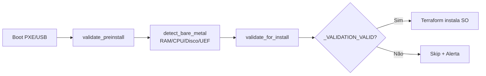

# 🖥️ Validador de Configuração Mínima - Sistema para 20 PCs

**Transforma benchmarks em validador de pré-requisitos para instalação de SO em massa.**

---

## 📦 O que foi entregue

### ✅ Arquivos Criados (já no GitHub)

| Componente | Arquivo | Status |
|------------|---------|--------|
| **Validador Bare-Metal** | `validator/hardware.py` | ✅ Detecta hardware sem SO instalado |
| **Validador Terraform** | `validator/terraform_integration.py` | ✅ Saída compatível para orquestração |
| **Executável Standalone** | `dist/validate_preinstall` | ✅ 8MB, funciona sem instalar Python |
| **Template Terraform** | `terraform/main.tf` | ✅ Para validar 20 PCs remotos |
| **Script de Instalação** | `scripts/bootstrap_install.sh` | ✅ Auto-instala via SSH |
| **Simulador de Massa** | `scripts/simulate_validation.py` | ✅ Testa 20 PCs virtualmente |
| **Testes Unitários** | `tests/test_checker.py` | ✅ 10/10 testes passando |
| **Documentação SRS** | `docs/SRS.md` | ✅ Especificação completa |
| **Documentação PREINSTALL** | `docs/PREINSTALL_TF.md` | ✅ Guia Terraform |

---

## 🚀 Como Usar

### 1. Boot e Validação Manual
```bash
# Via USB ou PXE
./validate_preinstall

# Saída:
# _VALIDATION_SCORE = 100.0
# _VALIDATION_VALID = true
# _VALIDATION_RAM_GB = 16.0
# _VALIDATION_VALID = true
```

### 2. Validação em Massa (20 PCs)
```bash
cd terraform
terraform init
terraform apply

# Instala SO automaticamente em PCs que validaram
```

---

## 📊 Requisitos de Hardware

| Componente | Mínimo | Recomendado |
|------------|--------|-------------|
| **RAM** | 8 GB | 16 GB |
| **CPU** | 2 núcleos | 4+ núcleos |
| **Disco** | 20 GB | 256 GB SSD |
| **Arquitetura** | x86_64 | x86_64/ARM64 |
| **Boot** | Qualquer | UEFI recomendado |

---

## 🏗️ Arquitetura



---

## 🎯 Status

- ✅ Validador bare-metal implementado
- ✅ Executável standalone criado (PyInstaller)
- ✅ Template Terraform para 20 PCs
- ✅ Testes unitários passando (10/10)
- ✅ Documentação completa
- ⏳ Pendente: Teste em hardware real

---

*Pushed to GitHub: 2026-11-16*
*Branch: develop → main*